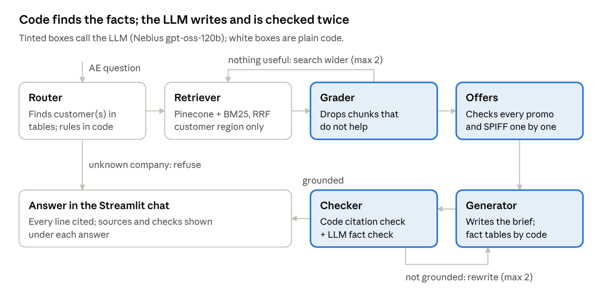

# Cloudpaw Renewal Agent

A RAG agent that helps account executives (AEs) plan software renewals. Name a customer and it checks the account's health and per-product consumption, applies that region's renewal, commission and promotion rules, reads recent meeting notes, and writes a renewal strategy where **every line cites its source**.

Built for *Mastering AI*, Week 2 (Track 2: LangChain + LangGraph).
**All data is fictional:** Cloudpaw Inc., Products A–J, customers, people and policies are invented.



## What it does

| Ask | What you get |
|---|---|
| "Build me a renewal strategy for Helvetia Logistics AG" | 7-section brief: blockers, snapshot, consumption, guardrails, every promotion checked, scenarios, next actions |
| "Compare Andes Retail Group with Helvetia Logistics" | Side by side, each customer held to its own region's rules |
| "What uplift can I put on Harbor City Transit Authority?" | Short cited answer (3% US Public Sector cap, notice by Dec 1, 2026) |
| "Build a renewal plan for Globex Corporation" | Refused: not a customer (decided in code, no LLM call) |

## How it works

```
router ─(unknown company → refuse)
  ↓
retriever → grader ─┬─ relevant ──→ offers → generator → checker ─┬─ grounded → answer
                    └─ nothing useful → search wider (max 2)        └─ not grounded → rewrite (max 2)
```

| Node | Job |
|---|---|
| router | Finds the customer(s) in the tables; computes dates, utilisation, true-up and cross-sell estimates in pandas; applies notice period, uplift cap, legal blockers, health play and accelerator in code (`src/rules.py`) |
| retriever | Hybrid search: Pinecone (meaning) + BM25 (keywords), merged with Reciprocal Rank Fusion; filtered to the customer's region + global + their own meeting transcripts. Short regional rule documents are pinned in full |
| grader | LLM keeps only useful chunks (one call for all chunks) |
| offers | LLM checks every promotion and SPIFF for eligibility, returned as JSON and rendered as a table |
| generator | Writes the answer; fact tables are built by code; every line must cite `[doc_id]` or `[Account data]` |
| checker | Code check (every line sourced, only real doc_ids) + LLM fact check; rewrites up to 2 times |

**Stack:** LangGraph · LangChain · Nebius AI Studio (`openai/gpt-oss-120b`, OpenAI-compatible, swappable in `.env`) · Pinecone · HuggingFace `all-MiniLM-L6-v2` embeddings · BM25 · pandas · Streamlit

## Results (25 golden questions, `python evaluate.py`)

| Metric | Target | Result |
|---|---|---|
| Right account and region | 100% | **100%** |
| Right document retrieved | 100% | **96%** |
| Faithfulness (no unsupported facts) | ≥ 90% | **88%** |
| Answer correct (every expected fact present) | ≥ 90% | **56%** (full briefs **100%**) |
| Refusals correct | all | **2/2** |
| Median latency | ~15 s | **14.7 s** |

When an answer is marked incorrect, it is usually true but incomplete (8 of 11), not wrong. Details are in `eval/evaluation_report.json` and `eval/evaluation_results.csv`.

## Run it

```bash
python -m venv .venv && source .venv/bin/activate
pip install -r requirements.txt
cp .env.example .env          # add your NEBIUS_API_KEY and PINECONE_API_KEY (never commit .env)
python -m src.ingest          # chunk + embed 29 policy docs and 12 transcripts into Pinecone (187 chunks)
streamlit run app.py          # chat app at http://localhost:8501
python evaluate.py            # score the 25 golden questions
```

## Project layout

```
app.py                 Streamlit chat (account card, sources panel, fact-check status)
evaluate.py            Golden-set evaluation → eval/evaluation_report.json
src/config.py          Settings (models, index, chunk size, top-k, retries)
src/ingest.py          Load → clean → chunk → embed → Pinecone (+ chunks.json for BM25)
src/retriever.py       Hybrid search (dense + BM25 + RRF)
src/accounts.py        Account lookup and all maths in pandas
src/rules.py           Notice, uplift, legal, health and accelerator rules applied in code
src/graph.py           LangGraph state graph
src/nodes/             router, retriever, grader, offers, generator, checker, llm
data/                  accounts, AE roster, contract lines, monthly consumption (CSV)
docs/                  29 policy documents (9 global + 4 per region)
transcripts/           12 customer meeting transcripts
eval/golden_set.csv    25 test questions with expected answers
```

## Limitations

Advises on one or two accounts at a time: no cross-account analytics (needs a SQL tool), no CRM write-back, no role-based access, and snapshot data with "today" fixed at Oct 17, 2026.
